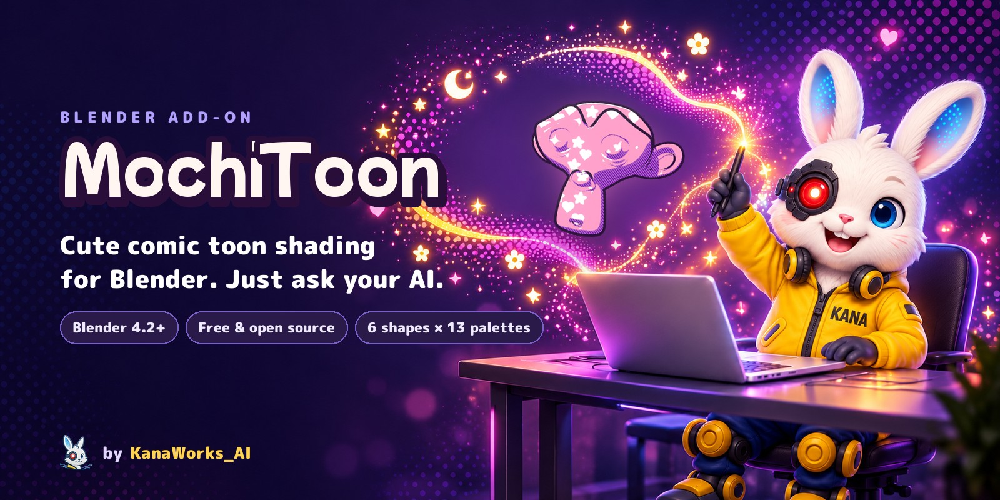
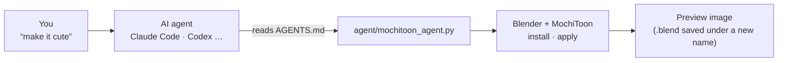

<div align="center">



<p>
  <a href="https://github.com/kanaworksai-hue/mochitoon/releases/latest"></a>
  
  
  
  
  <a href="LICENSE"></a>
  <a href="https://github.com/kanaworksai-hue/mochitoon/stargazers"></a>
</p>

<p><a href="https://github.com/kanaworksai-hue"></a>&nbsp;<a href="https://github.com/kanaworksai-hue"><b>A KanaWorks_AI project</b></a></p>

[日本語](README.md) | **English** | [简体中文](README.zh-CN.md)

[🎨 Gallery](#-gallery) · [🚀 Getting started](#-getting-started) · [🎛️ What you can tune](#️-what-you-can-tune) · [❓ FAQ](#-faq) · [⭐ Star](#-like-it-star-it)

</div>

**MochiToon** is a free Blender add-on that turns your 3D models into a cute comic (toon) look. It tints the shadows, scatters hearts and stars where the light hits, and adds hatching, a light rim and an outline, so the result looks like a printed comic. Your AI agent can install and apply it from one sentence, so you don't have to hunt for buttons. It works on all kinds of models: characters, props, logos, backgrounds.

<p align="center">
  
  <br><sub>The same scene before (left) and after (right).</sub>
</p>

## ✨ Highlights

<table>
<tr>
<td align="center" width="25%"><br><b>Just ask your AI</b><br><sub>One sentence to your AI agent. It installs, applies and renders a preview</sub></td>
<td align="center" width="25%"><br><b>6 shapes</b><br><sub>Circle, heart, star, flower, sparkle and moon. Mix them freely</sub></td>
<td align="center" width="25%"><br><b>13 palettes</b><br><sub>Each one sets the shadow color, line color and background</sub></td>
<td align="center" width="25%"><br><b>Reacts to light</b><br><sub>Soft in front light, sparkly in back light (light rim and glow)</sub></td>
</tr>
</table>

- **Five layers:** colored shadow, highlight shapes (halftone grid or scattered stickers), hatching, light rim, outline.
- **Colored shadows, not gray:** shadows take a color from the palette (pink → lilac, yellow → orange, and so on).
- **Outline:** its width follows the object's size automatically, and its color comes from the palette.
- **Keep your colors and textures:** keep each object's own color or texture and take only the shadow, shapes and lines from the palette.
- **Screen-space patterns:** hearts and dots keep the same size on screen, like real comic screentone. **Stick to Object** makes the pattern follow the object when it moves (not when it rotates).
- **One-click scene setup:** EEVEE, Standard view transform, a crisp sun, a flat background and bloom (Blender 5.0+).

## 🎨 Gallery

### Five layers


### Highlight shapes

Mix any of the six.


### Halftone or stickers


### Reacts to the light


### 13 palettes


## 🧭 How it works



Following [AGENTS.md](AGENTS.md), the agent downloads the latest release, installs it into Blender, applies it and renders a preview. AGENTS.md tells the agent to save a .blend under a new name and leave your original file alone unless you ask it to overwrite.

## 🚀 Getting started

### Ask your AI agent (recommended)

Send this to an AI agent that can work on your computer, such as Claude Code or Codex:

> Install MochiToon from https://github.com/kanaworksai-hue/mochitoon (follow its AGENTS.md) and make my Blender scene look like a cute comic.

Then fix it in one sentence while you look at the preview:

- "Fewer hearts"
- "Make the edges glow"
- "Only stars and moons"
- "Use the Neon Night palette"
- "No outline"

To keep your objects' own colors or textures, say so in your first request (for example, "keep my original colors").

### Install it yourself

**Requirements:** Blender 4.2 or later (tested on Blender 5.1 and 5.2), rendering with EEVEE.

1. Download `mochitoon-x.y.z.zip` from [Releases](https://github.com/kanaworksai-hue/mochitoon/releases/latest)
2. Blender → Edit → Preferences → Get Extensions → ▾ (top right) → **Install from Disk…** → pick the zip
3. In the 3D Viewport press **N** → **MochiToon** tab

### Use

1. Select objects
2. Pick a palette
3. **Make It Cute**
4. **Setup Cute Scene** (once per scene; replaces the World background with a flat color and adjusts your existing sun)
5. Fine-tune in **Look** and **Outline**

<p align="center">
  
</p>

## 🎛️ What you can tune

<details>
<summary><b>Main settings in the Look panel</b></summary>

| Setting | What it does |
|---|---|
| Base / Shadow Tint / Dots | Base color, the color added to the shadow, the color of the shapes |
| Shadow Size / Softness | How large the shadow is and how soft its edge is |
| Highlight Shapes | **Halftone** or **Sprinkle**, the six shape toggles, amount, Size (how wide the highlight area is), density, size variation, spin, angle |
| Hatching | Amount, density and angle of the hatching. Auto Color picks the line color from the shadow color |
| Rim Lights | A rim light on the shadow side, a light rim on the lit side, and Glow. They start at 0; the AI agent's recommended recipe turns them on |
| Stick to Object | Makes the pattern follow the object when it moves |
| Outline | Outline width and color, add or remove |

</details>

<details>
<summary><b>Palettes</b></summary>

Sakura (SAKURA), Lemon (LEMON), Mint (MINT), Soda (SODA), Grape (GRAPE), Peach (PEACH), Melon (MELON), Comic (COMIC), Neon Night (NEON_NIGHT), Choco (CHOCO), Pumpkin (PUMPKIN), Ghost (GHOST), Witch (WITCH)

The panel shows a preview image for each one.
</details>

## ❓ FAQ

<details>
<summary><b>Does it work in Cycles?</b></summary>

No. MochiToon uses the Shader to RGB node, which only works in EEVEE, so render with EEVEE. **Setup Cute Scene** switches to EEVEE for you.
</details>

<details>
<summary><b>I raised Glow, but nothing blooms.</b></summary>

The bloom is a compositor effect. On Blender 5.0 and later, **Setup Cute Scene** sets it up automatically. On Blender 4.2–4.5 the rim gets brighter but doesn't bloom. Bloom shows in renders; to see it in the viewport, set Viewport Shading → Compositor to Always.
</details>

<details>
<summary><b>Does it work with an orthographic camera?</b></summary>

Not yet. With an orthographic camera the hearts and stars get distorted and the hatching breaks up. Use a perspective camera.
</details>

<details>
<summary><b>What happens to my original materials?</b></summary>

**Make It Cute** replaces the materials of the selected objects with MochiToon materials. Press Ctrl+Z (Cmd+Z on a Mac) to undo. With **Keep Object Colors / Textures** on, the new MochiToon materials carry over each object's original color or texture.
</details>

<details>
<summary><b>The hearts look too big in a large render.</b></summary>

The shapes are sized relative to the screen, so a higher resolution doesn't make them smaller in the frame. Raise **Density** for smaller shapes.
</details>

<details>
<summary><b>Can I use my renders commercially?</b></summary>

Yes. Images and videos you render with MochiToon are your own work. The GPL applies to the add-on's code, not to what you make with it (follow the licenses of any models or textures you use).
</details>

## ⭐ Like it? Star it

If you like MochiToon, please click **⭐ Star** at the top right of the [repository page](https://github.com/kanaworksai-hue/mochitoon). It's free and takes one second.

- **More people find it.** Stars make the project easier to discover on GitHub.
- **It keeps updates coming.** It's what keeps me making new shapes and palettes.

You can also report a bug or ask for a feature in [Issues](https://github.com/kanaworksai-hue/mochitoon/issues), or share what you made on X and tag [@KanaWorks_AI](https://x.com/KanaWorks_AI).

## 🛠️ Development

```bash
# render a test image to tests/out/
blender -b --factory-startup --python tests/render_demo.py -- "$PWD/tests/out/demo.png" SAKURA 1

# operator smoke test
blender -b --factory-startup --python tests/test_ops.py

# build the extension zip into dist/
blender --factory-startup --command extension build --source-dir mochitoon --output-dir dist
```

```
mochitoon/
  nodes.py     the "MochiToon Core" shader node group (shadow, shapes, hatching, rims)
  core.py      applying materials, outline, scene setup
  api.py       make_cute(): one-call entry point for agents and scripts
  ops.py, ui.py  operators and panels
  palettes.py  the 13 palettes
agent/mochitoon_agent.py  command line for AI agents
```

## 📄 License and credits

- **This add-on:** Copyright © 2026 東京AI映像合同会社 (Tokyo AI Visuals LLC), released under [GPL-3.0-or-later](LICENSE).
- **Brand:** the KanaWorks_AI name, logo and the Kana character belong to 東京AI映像合同会社 (Tokyo AI Visuals LLC) and are **not** covered by the GPL. See [docs/brand](docs/brand/README.md).
- **Blender** is a trademark of the Blender Foundation. The sample images use Blender's built-in monkey, Suzanne, plus Halloween models made for this project (ghost, pumpkin, witch hat, bat).

This is an independent project. It is not affiliated with or endorsed by the Blender Foundation.

<br>

<div align="center">

<a href="https://x.com/KanaWorks_AI"></a>

<p><b>Made with ♥ by <a href="https://x.com/KanaWorks_AI">KanaWorks_AI</a></b></p>

<p><sub>If MochiToon made your work cuter, a ⭐ keeps the updates coming. More projects: <a href="https://github.com/kanaworksai-hue">github.com/kanaworksai-hue</a></sub></p>

</div>
