<div align="center">

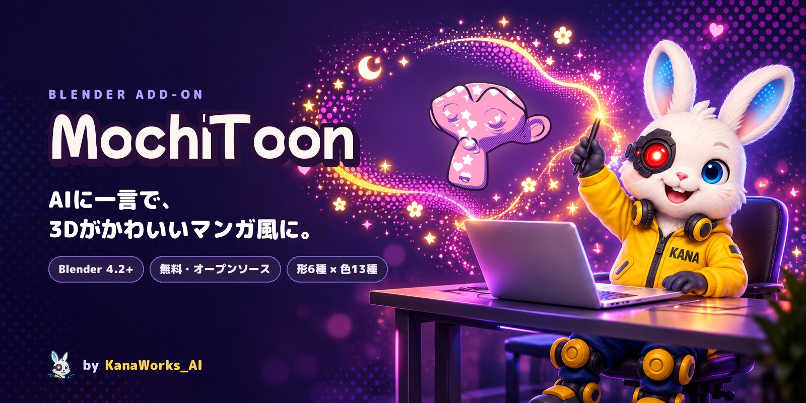

<p>
  <a href="https://github.com/kanaworksai-hue/mochitoon/releases/latest"></a>
  
  
  
  
  <a href="LICENSE"></a>
  <a href="https://github.com/kanaworksai-hue/mochitoon/stargazers"></a>
</p>

<p><a href="https://github.com/kanaworksai-hue"></a>&nbsp;<a href="https://github.com/kanaworksai-hue"><b>KanaWorks_AI のプロジェクト</b></a></p>

**日本語** | [English](README.en.md) | [简体中文](README.zh-CN.md)

[🎨 ギャラリー](#-ギャラリー) · [🚀 はじめかた](#-はじめかた) · [🎛️ 調整できること](#️-調整できること) · [❓ FAQ](#-faq) · [⭐ Star で応援](#-star-で応援する)

</div>

**MochiToon** は、Blender の 3D モデルをかわいいマンガ風（トゥーン調）に変える、無料の Blender アドオンです。影に色をのせ、光の当たる所にハートや星をちらし、斜線・縁の光・輪郭線を重ねて、印刷マンガのような見た目にします。インストールから適用まで AI エージェントに一言で頼めるので、自分でボタンを探す必要はありません。キャラクター、小物、ロゴ、背景など、いろいろなモデルに使えます。

<p align="center">
  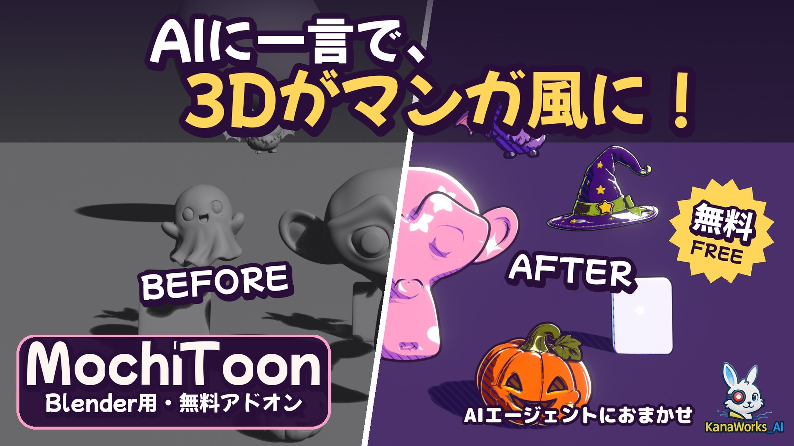
  <br><sub>同じシーンの適用前（左）と適用後（右）。</sub>
</p>

## ✨ 特長

<table>
<tr>
<td align="center" width="25%">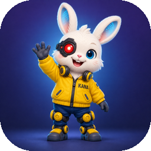<br><b>AIにおまかせ</b><br><sub>AI エージェントに一言頼むだけ。インストール、適用、プレビューまで自動</sub></td>
<td align="center" width="25%">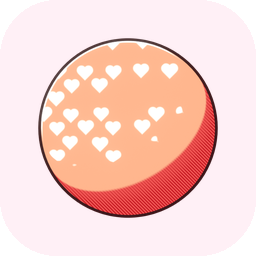<br><b>形は6種類</b><br><sub>丸・ハート・星・小花・キラキラ・月を自由に組み合わせ</sub></td>
<td align="center" width="25%">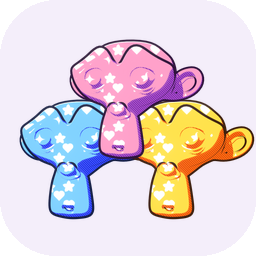<br><b>色は13種類</b><br><sub>影の色、線の色、背景までそろったパレット</sub></td>
<td align="center" width="25%">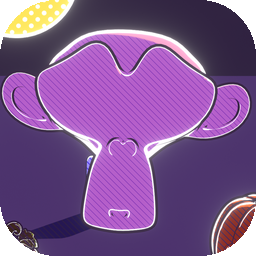<br><b>光で変わる</b><br><sub>順光でふんわり、逆光でキラッ（縁の光とグロー）</sub></td>
</tr>
</table>

- **5つのレイヤー：** 色つきの影、ハイライトの形（網点またはちらし）、斜線、縁の光、輪郭線。
- **灰色ではなく色つきの影：** 影にはパレットの色が入ります（ピンク→ラベンダー、黄→オレンジなど）。
- **輪郭線：** 太さはオブジェクトの大きさに合わせて自動で決まり、色はパレットに合わせて選ばれます。
- **元の色・テクスチャを活かせる：** オブジェクト自身の色やテクスチャはそのままにして、影・模様・線の色だけパレットのものを使えます。
- **模様は画面基準：** ハートや網点は画面に対して一定の大きさで、本物のスクリーントーンのように見えます。「Stick to Object」を使うと、模様がオブジェクトの移動についていきます（回転にはついていきません）。
- **ワンクリックのシーン設定：** EEVEE、Standard 表示、くっきりした太陽光、単色の背景、ブルーム（Blender 5.0 以降）をまとめて設定します。

## 🎨 ギャラリー

### 5つのレイヤー

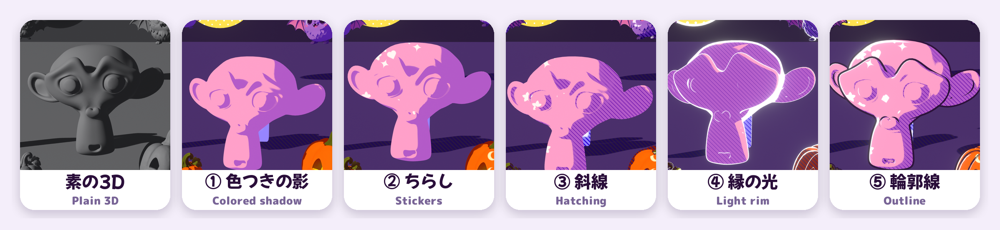

### ハイライトの形

6種類を自由に組み合わせられます。

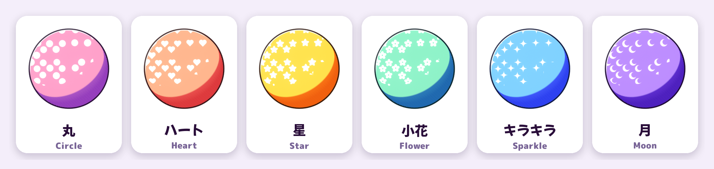

### 網点とちらし

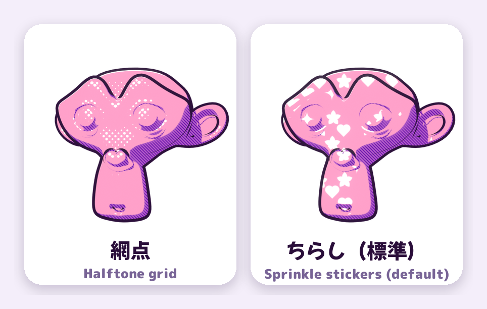

### 光の向きで変わる

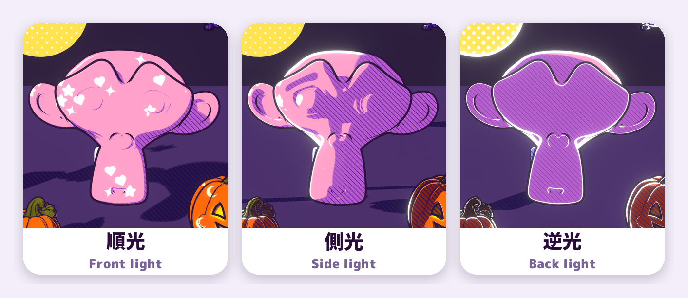

### パレット13種

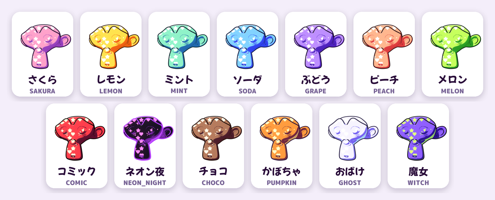

## 🧭 しくみ

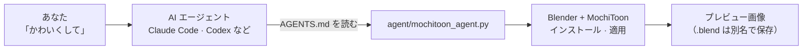

エージェントは [AGENTS.md](AGENTS.md) の手順に従って、最新リリースのダウンロード、Blender へのインストール、適用、プレビューの書き出しまでを行います。.blend ファイルに適用するときは、頼まれない限り元のファイルを上書きせず別名で保存するよう、AGENTS.md で指示しています。

## 🚀 はじめかた

### AI エージェントに頼む（おすすめ）

Claude Code や Codex のような、パソコンを操作できる AI エージェントにこう送るだけです。

> https://github.com/kanaworksai-hue/mochitoon の AGENTS.md に従って MochiToon をインストールして、私の Blender シーンをかわいいマンガ風にして。

そのあとは、プレビューを見ながら一言で直せます。

- 「ハートを少なめに」
- 「縁を光らせて」
- 「星と月だけにして」
- 「ネオン夜のパレットにして」
- 「輪郭線はなしで」

元の色やテクスチャを残したいときは、最初のお願いに「元の色はそのままで」と書き添えてください。

### 自分でインストールする

**必要なもの：** Blender 4.2 以降（Blender 5.1 と 5.2 で動作確認済み）、レンダーエンジンは EEVEE。

1. [Releases](https://github.com/kanaworksai-hue/mochitoon/releases/latest) から `mochitoon-x.y.z.zip` をダウンロード
2. Blender → 編集 → プリファレンス → エクステンションを入手 → 右上の ▾ → **ディスクからインストール…** → zip を選択
3. 3D ビューで **N** キー → **MochiToon** タブ

### 使い方

1. オブジェクトを選択
2. パレットを選ぶ
3. **Make It Cute**
4. **Setup Cute Scene**（シーンごとに1回。ワールドの背景は単色に置き換わり、既存の太陽光の設定も変わります）
5. **Look** と **Outline** で微調整

<p align="center">
  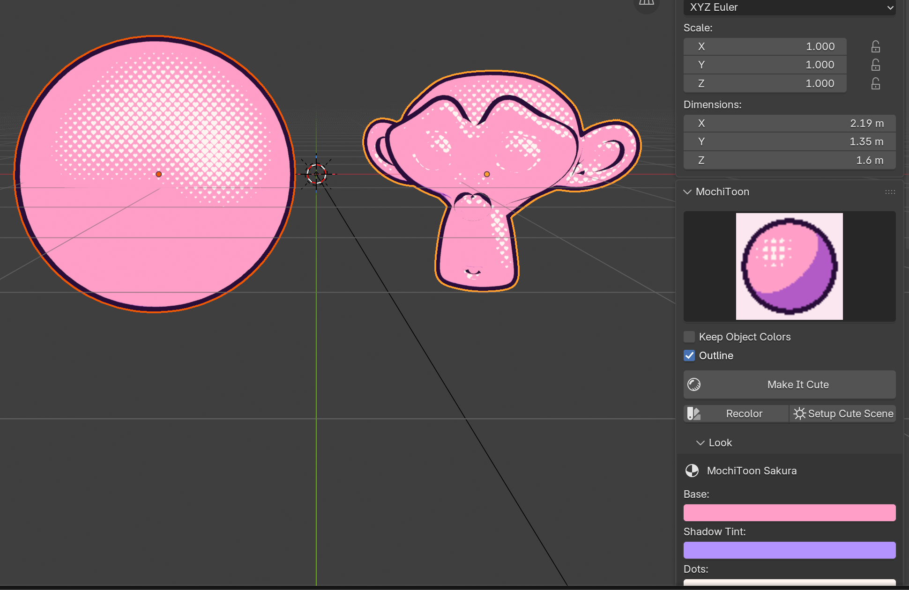
</p>

## 🎛️ 調整できること

<details>
<summary><b>Look パネルの主な項目</b></summary>

| 項目 | 内容 |
|---|---|
| Base / Shadow Tint / Dots | ベースの色、影にのせる色、模様の色 |
| Shadow Size / Softness | 影の広さと境目のやわらかさ |
| Highlight Shapes | **Halftone**（網点）か **Sprinkle**（ちらし）、6種類の形のオン・オフ、量・範囲（Size）・密度・大きさのばらつき・回転・角度 |
| Hatching | 斜線の量・密度・角度。Auto Color で影の色から線の色を自動で決める |
| Rim Lights | 影側のリムライト、光の当たる側の縁の光、Glow（グロー）。初期値は 0 で、AI エージェントのおすすめ設定ではオンになります |
| Stick to Object | 模様をオブジェクトの移動に追従させる |
| Outline | 輪郭線の太さと色、追加・削除 |

</details>

<details>
<summary><b>パレット一覧</b></summary>

さくら（SAKURA）、レモン（LEMON）、ミント（MINT）、ソーダ（SODA）、ぶどう（GRAPE）、ピーチ（PEACH）、メロン（MELON）、コミック（COMIC）、ネオン夜（NEON_NIGHT）、チョコ（CHOCO）、かぼちゃ（PUMPKIN）、おばけ（GHOST）、魔女（WITCH）

パネルではプレビュー画像を見ながら選べます。
</details>

## ❓ FAQ

<details>
<summary><b>Cycles でも使えますか？</b></summary>

使えません。MochiToon は EEVEE 専用の「Shader to RGB（シェーダーのRGB化）」ノードを使っているため、EEVEE でレンダリングしてください。**Setup Cute Scene** を押すと EEVEE に切り替わります。
</details>

<details>
<summary><b>Glow を上げても光がにじみません。</b></summary>

にじみ（ブルーム）はコンポジターで付けていて、Blender 5.0 以降で **Setup Cute Scene** を押すと自動で設定されます。Blender 4.2〜4.5 では縁が明るくなるだけで、にじみは付きません。にじみはレンダー結果に付きます。ビューポートで見るには、ビューポートシェーディングの「コンポジター」を「常時」にしてください。
</details>

<details>
<summary><b>平行投影（Orthographic）のカメラで使えますか？</b></summary>

まだ対応していません。平行投影だと、ハートや星の形がゆがみ、斜線も崩れます。透視投影（Perspective）のカメラを使ってください。
</details>

<details>
<summary><b>元のマテリアルはどうなりますか？</b></summary>

**Make It Cute** は、選んだオブジェクトのマテリアルを MochiToon のマテリアルに置き換えます。元に戻したいときは Ctrl+Z（Mac は Cmd+Z）で取り消せます。「Keep Object Colors / Textures」をオンにすると、元の色やテクスチャを引き継いだ MochiToon マテリアルが作られます。
</details>

<details>
<summary><b>大きな画像だと、ハートが大きすぎます。</b></summary>

模様は画面に対する大きさで決まるので、解像度を上げても画面の中での大きさは変わりません。もっと細かくしたいときは **Density**（密度）を上げてください。
</details>

<details>
<summary><b>作った画像や動画は商用で使えますか？</b></summary>

はい。MochiToon で作ったレンダリング画像や動画は、あなたの作品として自由に使えます。GPL が適用されるのはアドオン本体のコードで、それを使って作った作品には及びません（使ったモデルやテクスチャのライセンスには従ってください）。
</details>

## ⭐ Star で応援する

MochiToon を気に入ったら、[リポジトリのページ](https://github.com/kanaworksai-hue/mochitoon)の右上にある **⭐ Star** を押してもらえると嬉しいです。無料で、1秒で終わります。

- **もっと多くの人に届く：** Star が増えると GitHub で見つけてもらいやすくなります。
- **アップデートの励みになる：** 新しい形やパレットを作り続ける力になります。

ほかにも、バグや欲しい機能を [Issue](https://github.com/kanaworksai-hue/mochitoon/issues) で教えてもらったり、作品を X で [@KanaWorks_AI](https://x.com/KanaWorks_AI) をつけて見せてもらえたりすると、とても励みになります。

## 🛠️ 開発

```bash
# テスト画像を tests/out/ に1枚レンダリング
blender -b --factory-startup --python tests/render_demo.py -- "$PWD/tests/out/demo.png" SAKURA 1

# オペレーターのスモークテスト
blender -b --factory-startup --python tests/test_ops.py

# 配布用の zip を dist/ に作成
blender --factory-startup --command extension build --source-dir mochitoon --output-dir dist
```

```
mochitoon/
  nodes.py     「MochiToon Core」シェーダーノードグループ（影・模様・斜線・縁の光）
  core.py      マテリアルの適用、輪郭線、シーン設定
  api.py       make_cute()：エージェントやスクリプト向けの一括適用の入口
  ops.py, ui.py  オペレーターとパネル
  palettes.py  13種類のパレット
agent/mochitoon_agent.py  AI エージェント用のコマンドライン
```

## 📄 ライセンスとクレジット

- **このアドオン：** Copyright © 2026 東京AI映像合同会社。[GPL-3.0-or-later](LICENSE) で公開しています。
- **ブランド：** KanaWorks_AI の名称、ロゴ、キャラクター Kana の権利は東京AI映像合同会社に帰属し、GPL の対象**外**です。詳しくは [docs/brand](docs/brand/README.md) を見てください。
- **Blender** は Blender Foundation の商標です。サンプル画像には、Blender 標準のモンキー（Suzanne）と、作者が用意したハロウィンのモデル（おばけ、かぼちゃ、魔女の帽子、コウモリ）を使っています。

本プロジェクトは独立したプロジェクトで、Blender Foundation とは提携しておらず、承認も受けていません。

<br>

<div align="center">

<a href="https://x.com/KanaWorks_AI"></a>

<p><b>Made with ♥ by <a href="https://x.com/KanaWorks_AI">KanaWorks_AI</a></b></p>

<p><sub>MochiToon が役に立ったら、⭐ が次のアップデートの励みになります。ほかのプロジェクト：<a href="https://github.com/kanaworksai-hue">github.com/kanaworksai-hue</a></sub></p>

</div>
