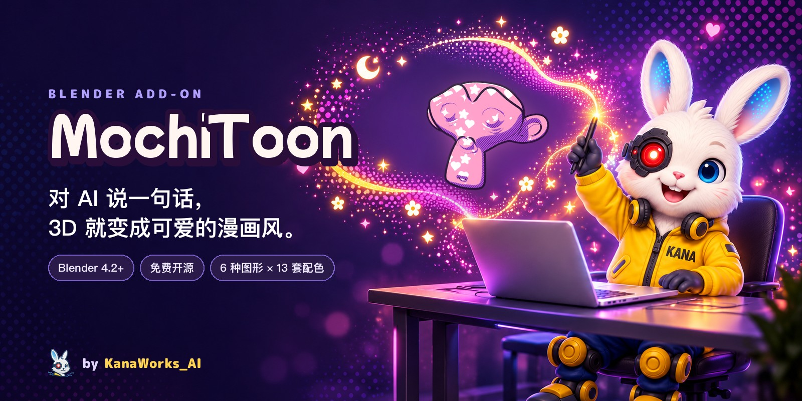
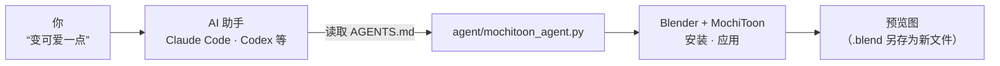

<div align="center">



<p>
  <a href="https://github.com/kanaworksai-hue/mochitoon/releases/latest"></a>
  
  
  
  
  <a href="LICENSE"></a>
  <a href="https://github.com/kanaworksai-hue/mochitoon/stargazers"></a>
</p>

<p><a href="https://github.com/kanaworksai-hue"></a>&nbsp;<a href="https://github.com/kanaworksai-hue"><b>KanaWorks_AI 出品</b></a></p>

[日本語](README.md) | [English](README.en.md) | **简体中文**

[🎨 效果一览](#-效果一览) · [🚀 开始使用](#-开始使用) · [🎛️ 可调整的设置](#️-可调整的设置) · [❓ FAQ](#-faq) · [⭐ 点个 Star](#-喜欢就点个-star)

</div>

**MochiToon** 是一个免费的 Blender 插件，能把 3D 模型变成可爱的漫画风（卡通渲染）。它会给阴影上色，在受光的地方撒上爱心和星星，再叠加排线、亮侧边缘光和描边，让画面像印刷出来的漫画。从安装到应用都可以用一句话交给 AI 助手，不用自己找按钮。角色、小物件、Logo、背景等各种模型都能用。

<p align="center">
  
  <br><sub>同一个场景的应用前（左）和应用后（右）。</sub>
</p>

## ✨ 特点

<table>
<tr>
<td align="center" width="25%"><br><b>交给 AI</b><br><sub>对 AI 助手说一句话，自动完成安装、应用和预览</sub></td>
<td align="center" width="25%"><br><b>6 种图形</b><br><sub>圆点、爱心、星星、小花、闪光、月亮，自由搭配</sub></td>
<td align="center" width="25%"><br><b>13 套配色</b><br><sub>阴影色、线条色、背景色都配好了</sub></td>
<td align="center" width="25%"><br><b>随光线变化</b><br><sub>顺光柔和，逆光闪亮（亮侧边缘光和 Glow 发光）</sub></td>
</tr>
</table>

- **五层叠加：** 彩色阴影、高光图形（网点或散布贴纸）、排线、亮侧边缘光、描边。
- **彩色阴影：** 阴影会带上配色里的颜色（粉→淡紫、黄→橙等）。
- **描边：** 粗细根据物体大小自动决定，颜色跟随配色。
- **保留原来的颜色和贴图：** 可以保留物体自己的颜色或贴图，只让阴影、图形和线条用配色里的颜色。
- **图案以屏幕为基准：** 爱心和网点在画面里保持同样大小，就像真正的漫画网点纸。打开 **Stick to Object** 后，图案会跟着物体移动（不跟随旋转）。
- **一键设置场景：** 一次设好 EEVEE、Standard 视图变换、清晰的太阳光、纯色背景和泛光（Bloom，Blender 5.0 及以上）。

## 🎨 效果一览

### 五层叠加


### 高光图形

六种图形可以自由搭配。


### 网点与散布贴纸


### 随光线变化


### 13 套配色


## 🧭 原理



AI 助手会按照 [AGENTS.md](AGENTS.md) 的步骤，下载最新版本、装进 Blender、应用效果并渲染预览。AGENTS.md 要求 AI 助手在处理 .blend 文件时另存为新文件，除非你要求覆盖，否则不改动原文件。

## 🚀 开始使用

### 交给 AI 助手（推荐）

把这句话发给 Claude Code、Codex 这类能操作电脑的 AI 助手：

> 按照 https://github.com/kanaworksai-hue/mochitoon 的 AGENTS.md 安装 MochiToon，然后把我的 Blender 场景变成可爱的漫画风。

之后看着预览，一句话就能调整：

- “爱心少一点”
- “让边缘发光”
- “只要星星和月亮”
- “换成霓虹夜配色”
- “不要描边”

想保留物体原来的颜色或贴图，请在第一句话里就说明（比如“保留原来的颜色”）。

### 自己安装

**需要：** Blender 4.2 及以上（已在 Blender 5.1 和 5.2 上测试），渲染引擎用 EEVEE。

1. 从 [Releases](https://github.com/kanaworksai-hue/mochitoon/releases/latest) 下载 `mochitoon-x.y.z.zip`
2. Blender → 编辑 → 偏好设置 → 获取扩展 → 右上角 ▾ → **从磁盘安装…** → 选这个 zip
3. 在 3D 视图里按 **N** → 打开 **MochiToon** 标签页

### 使用

1. 选中物体
2. 选一套配色
3. 点 **Make It Cute**
4. 点 **Setup Cute Scene**（每个场景点一次。会把世界环境换成纯色背景，并调整已有的日光）
5. 在 **Look** 和 **Outline** 里微调

<p align="center">
  
</p>

## 🎛️ 可调整的设置

<details>
<summary><b>Look 面板的主要设置</b></summary>

| 设置 | 作用 |
|---|---|
| Base / Shadow Tint / Dots | 底色、叠加到阴影上的颜色、图形的颜色 |
| Shadow Size / Softness | 阴影的范围和边缘的柔和度 |
| Highlight Shapes | **Halftone**（网点）或 **Sprinkle**（散布贴纸），六种图形的开关，数量、范围（Size）、密度、大小随机、旋转、角度 |
| Hatching | 排线的数量、密度、角度。Auto Color 会根据阴影色自动决定线的颜色 |
| Rim Lights | 阴影一侧的边缘光、亮侧边缘光，以及 Glow（发光）。初始值为 0，AI 助手的推荐设置会把它们打开 |
| Stick to Object | 让图案跟着物体移动 |
| Outline | 描边的粗细和颜色，添加或删除描边 |

</details>

<details>
<summary><b>配色一览</b></summary>

樱花（SAKURA）、柠檬（LEMON）、薄荷（MINT）、苏打（SODA）、葡萄（GRAPE）、蜜桃（PEACH）、蜜瓜（MELON）、漫画（COMIC）、霓虹夜（NEON_NIGHT）、巧克力（CHOCO）、南瓜（PUMPKIN）、幽灵（GHOST）、魔女（WITCH）

面板里可以看着预览图来选。
</details>

## ❓ FAQ

<details>
<summary><b>Cycles 能用吗？</b></summary>

不能。MochiToon 用到了只在 EEVEE 里有效的 Shader to RGB 节点，请用 EEVEE 渲染。点 **Setup Cute Scene** 会自动切换到 EEVEE。
</details>

<details>
<summary><b>开了 Glow，却没有泛光（Bloom）效果。</b></summary>

泛光是在合成器里加的。在 Blender 5.0 及以上点 **Setup Cute Scene** 会自动设置好。在 Blender 4.2–4.5 里边缘只会变亮，不会有泛光。泛光在渲染结果里可见；想在视图里看到，请把视图着色方式的“合成器”设为“总是”。
</details>

<details>
<summary><b>正交相机能用吗？</b></summary>

暂时不行。用正交相机时，爱心和星星会变形，排线也会乱掉。请用透视相机。
</details>

<details>
<summary><b>原来的材质会怎样？</b></summary>

**Make It Cute** 会把选中物体的材质换成 MochiToon 材质，按 Ctrl+Z（Mac 上是 Cmd+Z）可以撤销。打开 **Keep Object Colors / Textures** 后，新的 MochiToon 材质会沿用物体原来的颜色或贴图。
</details>

<details>
<summary><b>大尺寸渲染时爱心太大了。</b></summary>

图形的大小是相对画面决定的，提高分辨率并不会让它们在画面里变小。想要更小的图形，请调高 **Density**（密度）。
</details>

<details>
<summary><b>渲染出来的图片和视频可以商用吗？</b></summary>

可以。用 MochiToon 渲染的图片和视频是你自己的作品。GPL 只适用于插件本身的代码，不涉及你用它做出来的作品（请遵守所用模型和贴图的许可）。
</details>

## ⭐ 喜欢就点个 Star

如果你喜欢 MochiToon，请在[仓库页面](https://github.com/kanaworksai-hue/mochitoon)右上角点一下 **⭐ Star**。免费，一秒钟就好。

- **让更多人看到：** Star 越多，在 GitHub 上越容易被找到。
- **让更新继续下去：** 这是我继续做新图形、新配色的动力。

也欢迎在 [Issues](https://github.com/kanaworksai-hue/mochitoon/issues) 里反馈 bug 或想要的功能，或者在 X 上带上 [@KanaWorks_AI](https://x.com/KanaWorks_AI) 分享你的作品。

## 🛠️ 开发

```bash
# 渲染一张测试图到 tests/out/
blender -b --factory-startup --python tests/render_demo.py -- "$PWD/tests/out/demo.png" SAKURA 1

# 操作项冒烟测试
blender -b --factory-startup --python tests/test_ops.py

# 把扩展 zip 打包到 dist/
blender --factory-startup --command extension build --source-dir mochitoon --output-dir dist
```

```
mochitoon/
  nodes.py     “MochiToon Core”着色器节点组（阴影、图形、排线、边缘光）
  core.py      应用材质、描边、场景设置
  api.py       make_cute()：给 AI 助手和脚本用的一键入口
  ops.py, ui.py  操作和面板
  palettes.py  13 套配色
agent/mochitoon_agent.py  给 AI 助手用的命令行
```

## 📄 许可与致谢

- **本插件：** Copyright © 2026 东京AI映像合同会社，以 [GPL-3.0-or-later](LICENSE) 发布。
- **品牌：** KanaWorks_AI 的名称、logo 和 Kana 形象的权利归东京AI映像合同会社所有，**不在** GPL 授权范围内。详见 [docs/brand](docs/brand/README.md)。
- **Blender** 是 Blender Foundation 的商标。示例图里用的是 Blender 自带的猴头 Suzanne，以及作者为本项目准备的万圣节模型（幽灵、南瓜、魔女帽、蝙蝠）。

本项目是独立项目，与 Blender Foundation 没有合作或认可关系。

<br>

<div align="center">

<a href="https://x.com/KanaWorks_AI"></a>

<p><b>Made with ♥ by <a href="https://x.com/KanaWorks_AI">KanaWorks_AI</a></b></p>

<p><sub>如果 MochiToon 让你的作品更可爱了，点个 ⭐ 就是对更新最好的支持。更多项目：<a href="https://github.com/kanaworksai-hue">github.com/kanaworksai-hue</a></sub></p>

</div>
